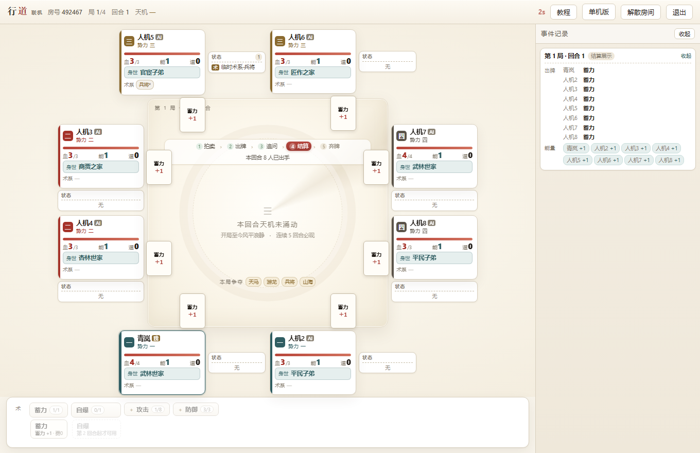
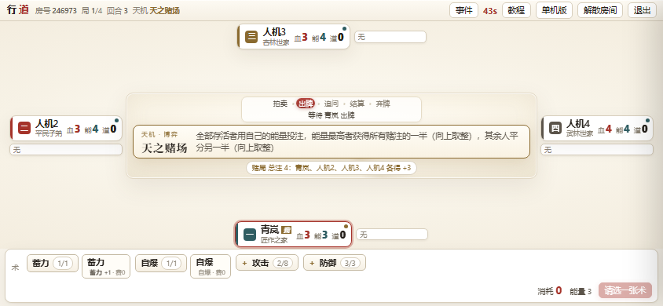
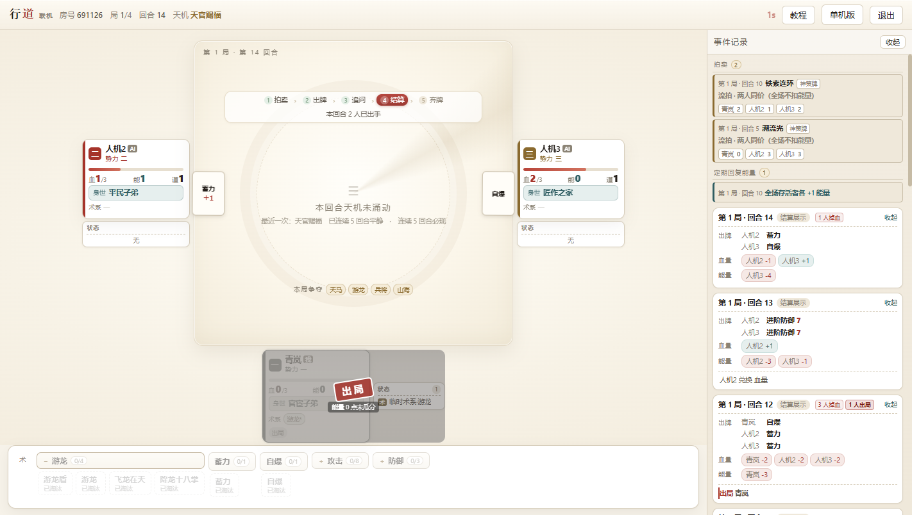

# 行道 · Xingdao

**一款支持 2–8 人联机的回合制卡牌对战游戏 —— 纯 JavaScript 全栈，零第三方依赖。**

同一份规则引擎同时运行在浏览器（单机人机）和 Node 服务端（联机对战）：没有框架、没有构建步骤、没有 npm 包，WebSocket 服务端是手写的。

[在线试玩（联机）](https://xingdao-332037-11-1500273890.sh.run.tcloudbase.com/online.html) ·
[单机版](https://game-d7g70hsywcc227f68-1500273890.tcloudbaseapp.com/) ·
[开发手册](docs/ENGINEERING.md)



---

## 这是什么

《行道》是一款四局制的暗选出牌对战游戏：所有人同时选择本回合的出牌，揭示后比数值、判定命中，直到只剩一个势力。

在此基础上叠了四层系统：

- **道牌** —— 33 种 / 60 张的公共牌库，可作神装永久装备，也可当一次性神通打出；每 5 回合拍卖一次
- **天机** —— 24 张全局事件牌，每回合 20% 概率触发（含保底），从「灵气潮汐」到「天官赐福」
- **身世** —— 6 种开局身份，各自带一条被动或主动特权
- **赊天** —— 用未来换现在：借能量，欠债会被天道没收道牌

游戏本体约 **1.33 万行**，**115 种卡牌**由 **73 个可组合的效果原子**描述，全部数据驱动。

---

## 技术亮点

**1. 纯函数结算内核 + 事件流**

```js
resolveTurn(m, actions, opts) → 新状态 + 事件流
```

引擎不 import 任何 IO，不认识任何中文牌名（`grep` 牌名在 `src/` 下 0 命中），只按 id 取原子列表。因此同一份 `src/` 既能在浏览器里跑单机对战，也能在 Node 里当联机裁判 —— 从结构上消除「双端规则漂移」。

**2. 视角投影层做信息隔离**

```js
viewFor(m, seat)        // 某个座位有权看到的那一份；seat = -1 即观战
auditView(v, m, seat)   // 结构性自检：公开区不该出现 hand / seed / dmgLog
```

手牌内容、随机种子、他人未揭示的选择都在这一层被裁掉；暗选期还会冻结公开数值，避免从血量/能量抖动反推对手出牌。客户端只发意图，可出牌与费用全部由服务端算好下发。

**3. 需要中途做选择的牌怎么办**

引擎是纯函数、不阻塞。遇到「符咒指谁」这类牌，服务端先克隆状态、用空答案**干跑一遍**收集 prompt 清单（随机序列一起复制，两次 prompt id 一致），问完再带答案真跑。没有把引擎改成协程，也没有给每张牌写预检。

**4. 三条贯穿全局的约束**

| 约束 | 原因 |
| --- | --- |
| 所有数值走定点数（1 单位 = 0.5 点） | 血量有 0.5 档，禁止浮点比较 |
| 所有随机走种子 RNG | 一局可完整复现，AI 推演与平衡复现共用 |
| 卡牌效果原子化 | 改数值/改文案不碰代码，加卡只需登记原子 |

---

## 快速开始

需要 Node.js 18+（无其他依赖）。

```bash
git clone <你的仓库地址>
cd xingdao

node test/run.mjs        # 156 条规则回归
node server/index.mjs    # 起联机服务，默认 8787
```

打开 `http://127.0.0.1:8787/online.html` 建房联机，或 `http://127.0.0.1:8787/index.html` 玩单机。

```bash
npm test                 # 规则回归
npm run sim              # 2000 场自对弈平衡报告
npm run e2e              # 真 WebSocket 客户端跑完整场
npm run e2e:web          # 真 Chrome + 4 个 iframe 跑完整场
npm run coverage         # 哪些卡引擎真的能跑
npm run view             # 打印「座位 0 的客户端会收到什么」
```

---

## 架构

```
                 ┌──────────────────────────────┐
  浏览器单机 ────▶│  src/engine.mjs  结算内核     │◀──── Node 服务端（联机）
  web/app.mjs    │  special · prompts · ai      │      server/room.mjs
                 └──────────────┬───────────────┘
                                │
                 ┌──────────────▼───────────────┐
                 │  src/view.mjs  视角投影       │──▶ 客户端渲染
                 └──────────────┬───────────────┘
                                │
                 data · config · units · rng（基座）
```

一回合的流转：

```
回合开始（补给 / 天机 / 拍卖）
  → 全员暗选出牌（客户端只发意图）
  → 追问（干跑收集 → 只问需要选目标的人）
  → 结算（道牌 order 队列 → 判定命中 → 淘汰清算 → 事件流）
  → 投影广播 → 客户端渲染 + 事件记录
```

服务端是一个 15 阶段的状态机，阶段推进全部由 `setTimer` 驱动；房间里一个人都没有时计时器会挂起，有人回来再续上。

---

## 目录

```
xingdao/
├─ src/          引擎（9 个文件，唯一真源码）
│   ├─ engine.mjs    结算内核
│   ├─ special.mjs   73 个效果原子的处理器（四个挂点 PRE/VALUE/COMBAT/POST）
│   ├─ prompts.mjs   追问系统
│   ├─ view.mjs      视角投影 + 泄漏自检
│   ├─ ai.mjs        L1 启发式 / L2 蒙特卡洛
│   └─ data config units rng
├─ server/       联机服务（房间状态机 · 手写 WebSocket · 静态站点）
├─ web/          前端（单机 + 联机 + 牌桌 + 事件记录 + 样式）
│   └─ src/      引擎副本（由 tools/build_web.py 生成，勿手改）
├─ data/         cards.json · effects.json（由 Excel 导入生成）
├─ test/         156 条规则回归
├─ tools/        卡表导入 · web 打包 · 截图 · 原子审计 · E2E
├─ cli/          自对弈 · 覆盖率 · 文本看局
└─ reports/      平衡报告
```

> `web/src/` 是 `src/` 的副本 —— 单机版在浏览器里跑的是它。**改完 `src/` 必须跑 `python tools/build_web.py` 重新同步**，否则单机版还是旧引擎。

---

## 测试与验证

| 手段 | 覆盖 |
| --- | --- |
| `test/run.mjs` | 156 条规则回归，每条对应一个裁定编号（R01–R83），改规则先补用例 |
| `server/e2e.mjs` | 真 WebSocket 客户端打完整场（支持 2v2 / 8 人） |
| `tools/web_e2e.mjs` | 真 Chrome + 多 iframe 加载真页面，专门抓「Node 能跑、浏览器白屏」 |
| `cli/selfplay.mjs` | 2000 场自对弈，输出局均回合、命中/判负比、卡牌使用率 |
| `tools/atom_audit.mjs` | 找出「有原子但没实现」的卡 |

浏览器 E2E 抓到过的三个真问题：多标签抢座、2v2 开局校验漏算、「自爆」第 1 回合可点（视图与引擎口径不一致）。

<p align="center">
  
  
</p>

---

## 部署

单进程镜像即可（云托管、VPS、Docker 都行）：

```bash
docker build -t xingdao .
docker run -p 8080:8080 xingdao
```

`Dockerfile` 只复制 `src/ data/ server/ web/` 四个目录，镜像很小。云托管配置见 `cloudbaserc.json`（`envId` 请换成你自己的环境）。

WebSocket 常驻需要**最小实例数 ≥ 1**，缩到 0 会在缩容时把房间掀掉。

---

## 已知限制

- 房间存在**进程内存**：服务重启会丢；空房保留 30 分钟后回收
- AI 的道牌估值是启发式（按类别与原子），不是精确收益模型
- 无账号系统，靠 6 位房号 + 本地 token 恢复座位
- 卡表源文件（Excel）不在本仓库，`data/*.json` 是它的快照；重新导入需要自备 xlsx
- 项目暂未声明开源许可证

---

## 文档

| 文档 | 内容 |
| --- | --- |
| [玩法说明](docs/GUIDE.md) | 面向玩家：一回合怎么走、血怎么掉、三类牌、十条新手建议 |
| [开发笔记](docs/ENGINEERING.md) | 架构决策、阶段挂点、已知偏差、规则冲突记录 |
| `docs/img/` | 界面截图 |

规则书本体（`卡牌.xlsx`、裁定文档）不在本仓库内。
